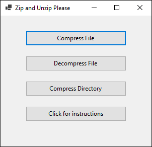
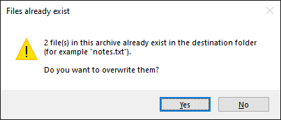
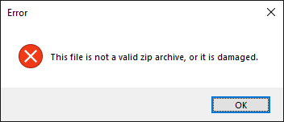

# File Compression System

## Description

The **File Compression System** is a Windows application designed to help users easily compress and decompress files. Using this tool, users can save storage space by compressing individual files or entire directories into **.zip** archives and easily extract them when needed.

This application offers a simple user interface for compressing a **single file**, compressing a **whole directory**, and **extracting** a .zip archive.



## Features

- **Compress Files**: Compress any single file (text, images, executables, documents) into a **.zip** archive. Files are stored byte-for-byte.
- **Compress Directories**: Compress entire directories into **.zip** format, including subfolders and empty folders.
- **Decompress Files**: Extract files from **.zip** archives. If files with the same names already exist in the destination, the app asks before overwriting them.
- **Large File Support**: Handles files and archives over 4 GB, using about 50 MB of memory regardless of file size.
- **Responsive UI**: Compression runs in the background, so the window never freezes. The buttons are disabled until the current operation finishes.
- **Error Handling**: User-friendly error messages for locked files, damaged archives, missing files and invalid save locations. A failed operation never leaves a half-written zip behind.

## Technologies Used

- **C#** (Programming Language)
- **.NET 9** with **Windows Forms** (UI Framework)
- **System.IO.Compression** (For compression and decompression)

## How It Compresses

The app creates standard **ZIP** archives using the **DEFLATE** algorithm, the same format Windows Explorer, 7-Zip and WinRAR use, so any zip tool can open its archives. .NET implements DEFLATE with the [zlib-ng](https://github.com/zlib-ng/zlib-ng) library, at its default balanced compression level.

DEFLATE works in two stages:

1. **LZ77 (removing repeats)**: The compressor scans the file while remembering the last 32 KB it has seen. When a run of bytes appears that it has already seen, it writes a short reference such as *"go back 1,200 bytes and copy 18 bytes"* instead of the bytes themselves. Text, logs, source code and spreadsheets repeat a lot, so this removes much of their size.
2. **Huffman coding (shorter codes for common symbols)**: The output of stage 1 is then re-encoded so that frequent symbols get short bit codes and rare ones get long codes, similar to how Morse code gives the common letter "E" a single dot.

DEFLATE is **lossless**: decompressing gives back exactly the original bytes. Decompression is much faster than compression, because it only follows the references and decodes the bits and never has to search for matches.

The ZIP format then wraps each compressed file with its name, folder path, size and a CRC-32 checksum. A **central directory** at the end of the archive lists every file, which lets the app check an archive for conflicts before extracting anything. Archives larger than 4 GB automatically use the **ZIP64** extension.

**How much will my files shrink?** It depends on how repetitive the data is:

| Type of data | Typical size after compression |
|---|---|
| Text, logs, CSV, source code | 15–40% of original |
| Executables, uncompressed documents | 40–60% of original |
| JPEG, PNG, MP4, MP3, existing .zip/.docx | ~100%, these are already compressed |

## Performance

Measured on an Intel Core i7-8700K with 32 GB RAM on Windows 10, using a Release build:

| Test | Compress | Size after | Extract |
|---|---|---|---|
| 100 MB text file | 1.6 s (62 MB/s) | 24% | — |
| 1.2 GB text file | 19 s (63 MB/s) | 24% | — |
| 4.5 GB text file | 74 s (62 MB/s) | 24% | 8–47 s |
| 1.2 GB random (incompressible) file | 31 s (39 MB/s) | 100% | — |
| Folder, 2 GB (half text, half random data) | 42 s (48 MB/s) | 62% | 3–4 s |
| Folder, 10,000 × 1 KB files | 1.7 s | 53% | 4.6 s |

- **Compression** runs at roughly **40–65 MB/s** on one CPU core. Compressible data (text) is faster than incompressible data.
- **Extraction** of large files runs at several hundred MB/s and is usually limited by disk speed. Antivirus scanning of newly written files can slow it down, which is why the 4.5 GB test ranged from 8 to 47 s.
- **Memory** use stays around **50 MB**, even for multi-gigabyte files, because files are streamed instead of being loaded into memory.
- With many small files, the first run can be much slower than shown above while Windows Defender scans each file the first time it's read. Run it again and the scan is cached.

## Compared to Other Tools

This app was tested against 7-Zip, WinRAR and the two zip tools built into Windows, using the same files on the same PC.

**In short:**

- **Fast ZIP compression.** On the text and mixed-file tests it made ZIP files 1.7–6× faster than the other ZIP tools. On the folder of 3,721 files, only 7-Zip was faster, by under a second.
- **Slightly larger ZIP files.** Its zips are about 1.5–2 percentage points bigger than 7-Zip's ZIP output (for example 36.9% vs 35.2% of the original for text), because it uses a faster compression setting.
- **Fast extraction.** It was the fastest to extract, or within 0.05 s of the fastest, in every test.
- **Low memory use.** It needed 21–34 MB, compared with up to 1.6 GB for 7-Zip's 7z format.
- **7z and RAR make smaller files.** On the text and mixed-folder tests, 7-Zip's 7z format and WinRAR shrank the data to 23–29% of its original size, against 31–37% for every ZIP tool. The 7z format was also 2–25× slower to compress than this app. WinRAR is paid software, and Windows 10 can't open either format without installing extra software.
- **Nothing shrinks already-compressed data.** On random data, which behaves like photos, videos and existing zips, every tool ended up at about 100%.

### Test data

| Test | What it is | Size |
|---|---|---|
| Text file | [enwik8](http://mattmahoney.net/dc/textdata.html), the first 100 MB of an English Wikipedia dump and a standard compression benchmark | 100 MB, 1 file |
| Mixed folder | [Silesia corpus](https://sun.aei.polsl.pl/~sdeor/index.php?page=silesia), a standard benchmark of text, programs, a database, images and XML | 212 MB, 12 files |
| Many files | The .NET SDK 9.0.301 folder (`C:\Program Files\dotnet\sdk\9.0.301`), mostly DLLs | 400 MB, 3,721 files |
| Random data | Random bytes. These behave like photos, videos and files that are already compressed | 315 MB, 1 file |

### Results

"Size after" is the archive size as a percentage of the original, so lower is better. Times are in seconds, and lower is better.

**Text file (enwik8, 100 MB)**

| Tool | Size after | Compress | Extract | Memory |
|---|---|---|---|---|
| **This app** | 36.9% | **1.7 s** | **0.3 s** | 21 MB |
| Windows PowerShell `Compress-Archive` | 36.5% | 5.2 s | 1.2 s | 244 MB |
| Windows `tar.exe` (ZIP) | 36.5% | 4.1 s | 0.4 s | 5 MB |
| 7-Zip (ZIP) | 35.2% | 9.9 s | 0.5 s | 12 MB |
| 7-Zip (7z) | **25.4%** | 42.8 s | 0.8 s | 382 MB |
| WinRAR (RAR) | 28.6% | 3.8 s | 0.3 s | 292 MB |

**Mixed folder (Silesia, 212 MB, 12 files)**

| Tool | Size after | Compress | Extract | Memory |
|---|---|---|---|---|
| **This app** | 32.5% | **2.9 s** | **0.4 s** | 22 MB |
| Windows PowerShell `Compress-Archive` | 32.2% | 8.1 s | 1.7 s | 456 MB |
| Windows `tar.exe` (ZIP) | 32.1% | 6.8 s | 0.7 s | 5 MB |
| 7-Zip (ZIP) | 31.0% | 5.1 s | 1.0 s | 117 MB |
| 7-Zip (7z) | **23.4%** | 22.6 s | 1.1 s | 908 MB |
| WinRAR (RAR) | 25.6% | 4.4 s | 0.6 s | 301 MB |

**Many files (.NET SDK folder, 400 MB, 3,721 files)**

| Tool | Size after | Compress | Extract | Memory |
|---|---|---|---|---|
| **This app** | 41.2% | 6.9 s | **2.9 s** | 34 MB |
| Windows PowerShell `Compress-Archive` | 40.3% | 25.7 s | 9.3 s | 621 MB |
| Windows `tar.exe` (ZIP) | 40.4% | 13.3 s | 3.2 s | 6 MB |
| 7-Zip (ZIP) | 39.4% | **6.1 s** | 5.5 s | 182 MB |
| 7-Zip (7z) | **22.9%** | 23.4 s | 4.8 s | 1,443 MB |
| WinRAR (RAR) | 36.1% | 9.8 s | 5.1 s | 304 MB |

**Random data (315 MB)**

| Tool | Size after | Compress | Extract | Memory |
|---|---|---|---|---|
| **This app** | 100.0% | 7.3 s | 0.2 s | 21 MB |
| Windows PowerShell `Compress-Archive` | 100.0% | 9.0 s | 0.7 s | 641 MB |
| Windows `tar.exe` (ZIP) | 100.1% | **6.5 s** | 0.8 s | 5 MB |
| 7-Zip (ZIP) | 100.0% | 7.9 s | 0.2 s | 12 MB |
| 7-Zip (7z) | 100.0% | 13.7 s | 0.3 s | 1,584 MB |
| WinRAR (RAR) | 100.0% | 14.3 s | 0.2 s | 304 MB |

### How it was measured

- **PC:** Intel Core i7-8700K (6 cores, 12 threads), 32 GB RAM, Samsung 850 EVO SATA SSD, Windows 10 22H2, with Windows Defender on.
- **Versions:**
  - This app: Release build on .NET 9.0.6.
  - 7-Zip 26.04.
  - WinRAR 7.23.
  - Windows `tar.exe` (bsdtar 3.5.2), run with `-a` to create a zip.
  - Windows PowerShell 5.1 `Compress-Archive` / `Expand-Archive`.
- **Settings:** every tool used its default settings. 7-Zip and WinRAR use all CPU cores. This app and the Windows tools use one core.
- **Timing:** each test ran 3 times and the middle result is shown. Times include starting the program.
- **Memory:** the peak memory of the process while compressing. This app was measured with a small console program that calls the same `FileCompUtility` code, so the app's window adds some memory on top.
- **Verification:** every extracted file was checked against the original with SHA-256. All tools passed every test.
- **Not tested:** Windows Explorer's *Send to > Compressed (zipped) folder*, because it can't be timed from a script.

## Getting Started

### Requirements

- Windows 10 or 11
- [.NET 9 SDK](https://dotnet.microsoft.com/download/dotnet/9.0) to build from source

### Run from source

```bash
git clone https://github.com/Ushmayne/File-Compression-Utility.git
cd File-Compression-Utility
dotnet run --project FileCompressionUtility
```

You can also open `File-Compression-Utility.sln` in Visual Studio 2022 and press **F5**.

### Run the tests

```bash
dotnet test
```

The tests in `tests/FileCompressionUtility.Tests` cover:

- compressing and extracting files and folders, checking the output byte for byte
- overwrite protection
- damaged and fake zip files
- archives that try to write outside the destination folder
- cleanup after a failed operation

### Build a standalone .exe

```bash
dotnet publish FileCompressionUtility -c Release -r win-x64 --self-contained -p:PublishSingleFile=true -o publish
```

This produces a single `publish/FileCompressionUtility.exe` (about 110 MB) that runs on any 64-bit Windows PC without installing .NET. For a much smaller exe (about 180 KB) that requires the [.NET 9 Desktop Runtime](https://dotnet.microsoft.com/download/dotnet/9.0), use `--self-contained false` instead.

## How to Use

1. **Compressing a File**:
    - Click **Compress File** and select the file you want to compress.
    - Choose where to save the **.zip** archive.

2. **Compressing a Directory**:
    - Click **Compress Directory** and select a folder.
    - Choose where to save the **.zip** archive. It must be outside the folder being compressed.
    - The folder's contents are compressed, preserving the subfolder structure.

3. **Decompressing a File**:
    - Click **Decompress File** and select a **.zip** file.
    - Choose the folder to extract into.
    - If any files already exist there, you'll be asked whether to overwrite them. Choosing **No** cancels without extracting anything.

      

## Good to Know

- **Empty folders**: Compressing an empty folder creates a valid, empty zip. Empty subfolders are kept inside archives.
- **Folder name**: The selected folder's *contents* go into the zip, not the folder itself. Extracting puts those contents directly in the destination folder.
- **Damaged archives**: Corrupted or non-zip files are rejected with an error message before anything is extracted.

  

- **Safety**: Archives containing paths that try to escape the destination folder (for example `../file.txt`) are blocked.
